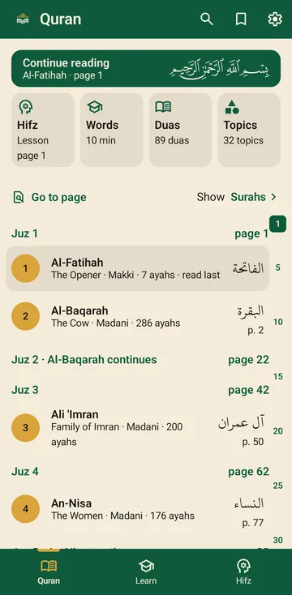
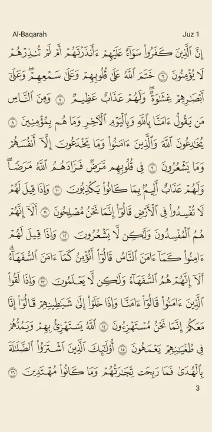
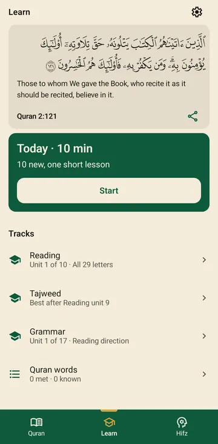
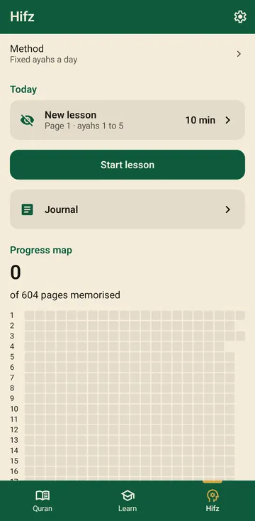
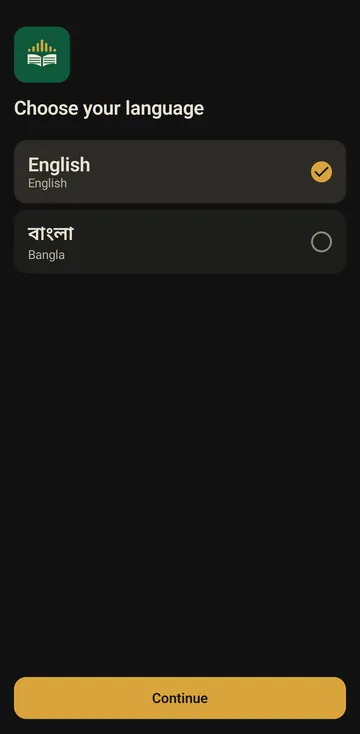
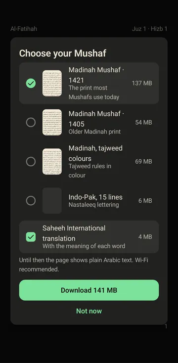

<p align="center">
  
</p>

<h1 align="center">Awn (عون)</h1>

<p align="center">A free Android app for reading, listening to, reciting and memorising the Quran. No ads, no account, no payment.</p>

<p align="center">
  <a href="https://github.com/shourovrm/awn/releases/latest"><b>Download the latest APK</b></a>
</p>

<p align="center">
  
  
  
  
</p>

## What Awn does

Awn shows the Quran as the printed Mushaf, page for page, in the edition you know: the Madinah Mushaf (1421 or 1405 print, or with tajweed colours) or the 15-line Indo-Pak Mushaf. A tap on a word shows its meaning; a translation in English or Bangla can sit under the Arabic; a reciter can read the page aloud while the words light up.

Awn also listens. When you recite to the phone, it follows your words on the page and marks the ones it did not hear, entirely on the device, with nothing sent anywhere. That is the base of the Hifz tab (memorising) and of the practice in Learn.

- **Quran**: Madinah and Indo-Pak editions, translations, word-by-word meanings, six reciters, bookmarks, search by typing or by reciting an ayah, duas from the Quran by topic.
- **Learn**: four tracks of short lessons, Reading (ten units that follow the Noorani Qaida), Tajweed, Grammar and Quran words, with a ten-minute lesson a day and spaced revision of what you have read.
- **Hifz**: memorising by a method you choose (Sabaq, Sabqi and Manzil; three by three; the ayah chain; a fixed number of ayahs a day; or plain tracking), today's lesson and revision, a journal, and a map of the 604 pages showing what you know.

The whole app is in English and Bangla. The Quran text, the layouts of each Mushaf and the fonts are the same files Quran.com uses.

## Getting Awn on your phone

Awn runs on Android 8.0 or newer. It is not on the Play Store yet, so you install the file yourself:

1. Open the [latest release](https://github.com/shourovrm/awn/releases/latest) and download `app-github-arm64-v8a-release.apk`. That file fits almost every phone sold since 2017. An old 32-bit phone needs `armeabi-v7a` instead.
2. Open the downloaded file. Android asks once to allow installs from your browser or file manager; allow it.
3. Open Awn.

A newer version is installed the same way, over the old one; your bookmarks and progress stay.

## Your first minutes

<p>
  
  
</p>

Awn asks for your language, then opens the Quran. The first page shows one card: choose the Mushaf you want to read and whether to download a translation with word meanings. Until the download is done the page shows plain Arabic text, and you can keep reading while it runs. The Madinah 1421 Mushaf is about 137 MB; the Indo-Pak Mushaf is 6 MB; a translation with word meanings is about 4 MB. Wi-Fi is recommended.

<br clear="all">

Reciting needs one more download, 86 MB, the first time you tap the microphone. Before that, Awn shows a short notice: the Quran is learned from a teacher, Awn helps you practise between lessons, and the computer that listens to you can be wrong.

Everything you download is listed under Settings, Storage, where any of it can be removed again. A switch under Settings, Audio limits every download to Wi-Fi.

## Privacy

Awn has no account, no analytics and no advertising. It connects to the internet only to fetch what you ask for: the Mushaf, translations, reciter audio, the recitation checker and app updates, all from this project's GitHub releases and the sources credited below. Your recitation is processed on the phone and never leaves it. Bookmarks, saved ayahs and recent pages can be saved to a file and restored from it under Settings, Backup.

## The notice

Awn's recitation checker is a computer model and can be wrong. It is for assistance only and is not a replacement for a proficient, authorised teacher, because the Quran is only received through oral transmission (mushafahah). The notice appears in the app the first time Learn or the microphone is opened.

বাংলা: এই অ্যাপ একটি কৃত্রিম বুদ্ধিমত্তা (এআই) মডেল, যা ভুল করতে পারে। এটি কেবল সহায়তার জন্য; এর ওপর নির্ভর করা উচিত নয়। এটি একজন দক্ষ ও অনুমোদিত শিক্ষকের বিকল্প নয়, কারণ কুরআন কেবল মৌখিক ধারায় (মুশাফাহা) গ্রহণ করা হয়।

العربية: هذا المعلّم القرآني نموذج ذكاء اصطناعي قد يخطئ؛ فهو للإعانة فقط ولا يُعتمد عليه، وليس بديلاً عن معلّمٍ مُتقِنٍ مُجاز؛ لأنّ القرآن لا يُؤخذ إلا بالمشافهة.

## Help and feedback

A mistake in the Quran text, a translation or a word timing is the most important kind of report: open an issue with the surah, ayah and the Mushaf you were reading. Other bugs and ideas go to the same place: [issues](https://github.com/shourovrm/awn/issues).

---

## For developers

The rest of this page is for people who build Awn from source or contribute to it.

### Licence

The source is available under MIT plus the Awn additional conditions in `LICENSE`: free to every end user, no advertising, no charges or in-app purchases, the AI-advisory notice stays, and the conditions pass to forks. Because the conditions restrict selling, the project is source-available rather than OSI open source, and it is not on F-Droid for that reason.

### Verifying a downloaded APK

Every release is signed with one key. Its SHA-256 certificate fingerprint is:

```
E7:AC:D7:83:3F:50:FA:B5:ED:90:D2:AB:33:CB:26:31:9F:E1:39:8B:25:3A:8F:21:3C:CD:70:67:CC:3D:DA:34
```

```sh
sha256sum -c SHA256SUMS.txt                                   # the file next to the APKs in the release
apksigner verify --print-certs app-github-arm64-v8a-release.apk   # Android SDK build-tools
```

The line `Signer #1 certificate SHA-256 digest` must equal the fingerprint above without colons, in lower case. Each release also carries a GitHub build-provenance attestation.

### Building

Requirements: Temurin JDK 21, the Android SDK with platform 37 and build-tools 36.0.0, and a signing key. Every build is a signed release build; there is no debug variant.

```sh
export JAVA_HOME=/path/to/temurin-21
export ANDROID_HOME=$HOME/android-sdk
echo "sdk.dir=$ANDROID_HOME" > local.properties
```

The signing key lives in `~/.gradle/gradle.properties`, never in the repository. A test key is enough to build (`keytool -genkeypair -keystore ~/my-awn.jks -alias awn -keyalg RSA -keysize 4096 -validity 10000`); an APK signed with it cannot update the official app.

```
AWN_KEYSTORE_PATH=/path/to/your.jks
AWN_KEYSTORE_PASSWORD=...
AWN_KEY_ALIAS=...
AWN_KEY_PASSWORD=...
```

```sh
./gradlew assembleGithubRelease      # APKs in app/build/outputs/apk/github/release/
./gradlew installGithubRelease       # to a connected phone
```

The first build downloads the sherpa-onnx libraries (`fetchNativeLibs`) and the pinned Quran text and manifests (`:core:data:fetchBundledPacks`) and checks their SHA-256 hashes. `./gradlew fetchModels` fetches the speech model for the tracker tests; the app downloads the same files on first use of recite.

### Testing

```sh
./gradlew spotlessCheck detekt lintGithubRelease testGithubReleaseUnitTest
./gradlew connectedGithubReleaseAndroidTest      # needs an emulator or phone
```

`spotlessApply` formats the code. The tracker tests run on the PC against the real speech model.

### How it is put together

| Module | Holds |
|---|---|
| `app` | navigation, the tabs, Settings, first run, the services object |
| `core/data` | the Quran text, pack catalogue and downloads, bookmarks, the speech-model store |
| `core/ui` | theme, colours, typography, shared components |
| `core/quranfont` | the page fonts of each Mushaf edition |
| `feature/read` | the Quran screen, page layout, word cards, the Mushaf chooser |
| `feature/listen`, `player` | reciter audio, downloads, the play panel |
| `feature/recite`, `tracker` | the microphone, the on-device alignment of your words to the page |
| `feature/learn`, `feature/hifz`, `feature/duas` | the Learn, Hifz and Duas tabs |

The APK ships only the Quran text and layout, the Hafs font and the manifests, each pinned by SHA-256. Translations, word packs, audio and the speech model are downloaded after install from this repository's data releases (`data-v1`, `models-v1`) and verified against their manifest hash. The plan is `docs/plan.md`; decisions live under `docs/decisions/`; the copy rules are in `docs/copy.md`.

### Contributing

See `CONTRIBUTING.md`. Contributions are accepted under the repository licence. Awn depends on no other Quran app's code.

### Credits

- Quran-Lab, Zipformer P-Arabic v3 speech model, under the NPL-1.2 licence (`awn-models/NPL-1.2.txt` in the models release): https://huggingface.co/Quran-Lab/zipformer_p-arabic-v3
- k2-fsa, sherpa-onnx, runs the model on the device: https://github.com/k2-fsa/sherpa-onnx
- Microsoft, ONNX Runtime, inside sherpa-onnx: https://github.com/microsoft/onnxruntime
- Quran.com / Tarteel QUL, Quran text, layouts, fonts and word timings: https://qul.tarteel.ai
- QuranicAudio and EveryAyah, reciter audio.
- Bangla Wikipedia, list of surahs, spoken Bangla surah names and their meanings (CC BY-SA 4.0): https://bn.wikipedia.org/wiki/কুরআনের_সূরার_তালিকা
- Google, Jetpack Compose, Room, DataStore, Navigation and Media3 (Apache-2.0).

Learn:

- Qari Noor Muhammad, *Al-Qaida An-Nooraniyya* (Noorani Qaida): the Reading units follow its order and practice, used for non-commercial purposes: https://archive.org/details/noorani-qaida_202011
- Islamic Home Schooling Academy of New Zealand, Noorani Qaida video lessons 1 to 17, letter and practice audio, under CC BY: https://www.youtube.com/channel/UCX766Oi2anGGIkIgMJXu9ng
- Wikibooks, *Arabic* (CC BY-SA 4.0), and William Wright, *A Grammar of the Arabic Language* (public domain): lesson facts and examples. Details in `content/lessons/README.md`.

Translations:

- Saheeh International and M.A.S. Abdel Haleem, English, via Quran.com / Quran Foundation API: https://quran.com
- Muhammad Asad, *The Message of the Qur'an*, English, translation only, via Al Quran Cloud, edition en.asad: https://alquran.cloud
- Dr. Abu Bakr Muhammad Zakaria, Bangla, via Quran.com / Quran Foundation API: https://quran.com
- Quantum Foundation, Bangla (meaning-based): https://alquran.org.bd
- English transliteration and word-by-word meanings in English and Bangla, via Quran.com / Quran Foundation API: https://quran.com

Each source is also credited in the app under Settings, About, Credits, and in the pack manifests.
